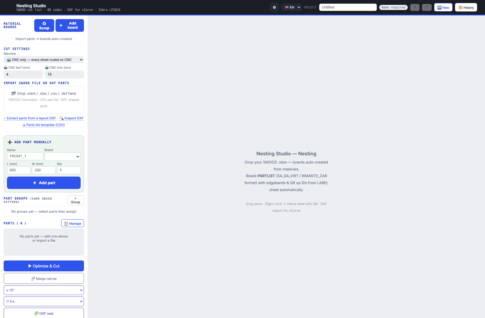

# Nesting Studio — cut optimisation with a true-shape engine

**Less offcut per sheet is money, on every sheet.** Imports a real CAD part list, nests it,
and produces the cut list, the labels and the machine files.



**Live:** <https://gervdalius-droid.github.io/nesting/>

> **This is a demo build.** The tool it comes from runs daily in a furniture workshop against
> a shared stock database. This version has the cloud, the shared login and the warehouse
> integration removed, and carries no credentials — the nesting engine, the importers and the
> exporters all run entirely in your browser. Nothing leaves the page.

## Why this exists

Sheet material is the biggest consumable in a furniture workshop. Commercial nesting is sold
per seat per month and still won't read the files our CAD actually produces without an export
dance. This reads them directly and nests in the browser.

## What it does

**Imports what a workshop already has** — a SWOOD project (`.xlsm` / `.xlsx`), a CSV part
list, or shaped parts straight from **DXF**. Boards are created automatically from the
project's materials. It reads the `PARTLIST` sheet and picks up edgebands and QR operation
IDs from the `LABEL` sheet.

**Two nesting modes, deliberately different:**

| | Engine | For |
|---|---|---|
| **Optimize & Cut** | rectangular strip packing | panels — the 95 % case, fast |
| **Shape nest** | [jagua-rs](https://github.com/JeroenGar/jagua-rs) compiled to WebAssembly | irregular / curved parts from DXF |

The true-shape engine is Rust compiled with `wasm-bindgen-rayon`, so it runs multi-threaded in
Web Workers behind `SharedArrayBuffer` — which is why the page ships `coi-serviceworker.js` to
make itself cross-origin isolated on GitHub Pages.

**Outputs a workshop uses** — cut list, Zebra LP2824 labels with QR codes, and DXF export for
vCarve. Offcuts can be re-imported as boards so a usable remnant gets used instead of cut from
a full sheet.

## Things I learned the hard way

- **Finer rotation steps make the result worse.** More candidate angles should intuitively
  pack tighter; in practice they starve the left-bottom-fill heuristic. Coarser steps plus
  more random restarts beat finer steps.
- **Demand grouping pays for the search.** Collapsing identical parts into a demand count
  frees enough time budget to run a best-of-many seed search, which is where the gain is.
- **`nestPoly` must stay full-resolution.** Simplifying the polygon before nesting loses
  exactly the concavities that let parts interlock.
- **Adding a DXF entity type touches seven places** — the easy one to miss is the `commit()`
  whitelist, which silently drops the entity instead of erroring.

## Run it

```bash
python3 -m http.server 8080    # then open http://localhost:8080/
```

The threaded WASM engine needs cross-origin isolation, which `coi-serviceworker.js` arranges
when the page is served over HTTP.

## Built with

Vanilla JavaScript (~17,000 lines) · Rust → WebAssembly (jagua-rs, wasm-bindgen-rayon) ·
Web Workers · SharedArrayBuffer · HTML Canvas. No build step, no `node_modules`.
